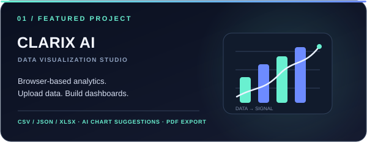
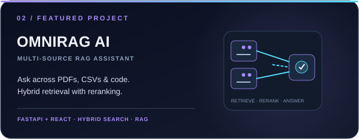
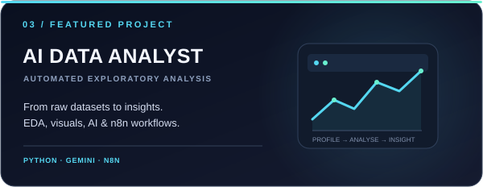
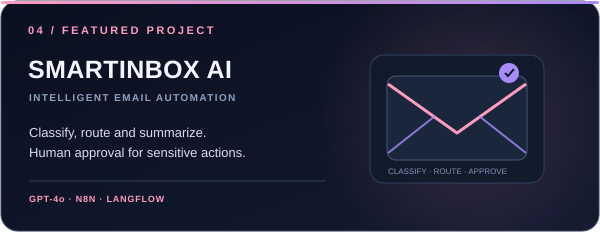
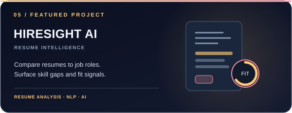
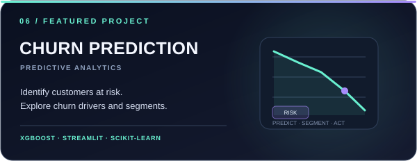

<div align="center">


<br>

<a href="https://manas-shukla-portfolio.framer.website"></a>
<a href="https://linkedin.com/in/manas-shukla-006774370"></a>
<a href="mailto:shuklamanas89282@gmail.com"></a>
<a href="https://github.com/manas-shukla-101?tab=repositories"></a>

</div>

<br>

<div align="center">

**I build at the intersection of AI, data and software.**

From intelligent document systems to data products and workflow automation, I enjoy turning technical ideas into useful applications.

</div>

---

<div align="center">

</div>

<table>
<tr>
<td width="58%" valign="top">

### THE OPERATOR

I'm **Manas Shukla**, a B.Sc. Data Science student based in Mumbai, India.

I’m interested in how intelligent systems work end to end — from data processing and model logic to APIs, interfaces and automation.

I learn by building, testing assumptions and improving the product one iteration at a time.

**Currently interested in:** applied AI · machine learning · RAG systems · computer vision · analytics engineering

</td>
<td width="42%" valign="top">

### SYSTEM READOUT

```yaml
identity: Manas Shukla
base: Mumbai, India
track: B.Sc. Data Science
building:
  - AI-powered applications
  - data-driven products
  - automation workflows
mindset: learn_by_building
open_to:
  - internships
  - collaborations
  - interesting problems
```

</td>
</tr>
</table>

---

<div align="center">

</div>

<div align="center">

### SELECTED BUILDS
*Six projects. Six different problems. One consistent approach: make technology useful.*

</div>

<table>
<tr>
<td width="50%" valign="top">
<a href="https://github.com/manas-shukla-101/Clarix-AI">

</a>
</td>
<td width="50%" valign="top">
<a href="https://github.com/manas-shukla-101/OmniRag-AI">

</a>
</td>
</tr>
<tr>
<td width="50%" valign="top">
<a href="https://github.com/manas-shukla-101/AI-Data-Analyst-Agent">

</a>
</td>
<td width="50%" valign="top">
<a href="https://github.com/manas-shukla-101/SmartInbox-AI">

</a>
</td>
</tr>
<tr>
<td width="50%" valign="top">
<a href="https://github.com/manas-shukla-101/HireSight-AI">

</a>
</td>
<td width="50%" valign="top">
<a href="https://github.com/manas-shukla-101/Customer-Churn-Prediction-System">

</a>
</td>
</tr>
</table>

<div align="center">

<a href="https://github.com/manas-shukla-101?tab=repositories"><strong>VIEW ALL REPOSITORIES ↗</strong></a>

</div>

---

<div align="center">

</div>

<table>
<tr>
<td width="33%" valign="top">

### 01 / INTELLIGENCE

- Python
- Machine Learning
- LLM applications
- Retrieval-Augmented Generation
- NLP
- Computer Vision

</td>
<td width="33%" valign="top">

### 02 / DATA

- Pandas & NumPy
- Exploratory Data Analysis
- Matplotlib & Seaborn
- Power BI
- Advanced Excel
- SQL

</td>
<td width="33%" valign="top">

### 03 / ENGINEERING

- FastAPI
- React
- Streamlit
- n8n workflows
- APIs & integrations
- Git & GitHub

</td>
</tr>
</table>

<div align="center">


</div>

---

<div align="center">

</div>

<table>
<tr>
<td width="50%" valign="top">

### IN THE WORKSHOP

**What I'm exploring now**

- Building more reliable AI-powered applications
- Understanding retrieval, evaluation and grounding in RAG
- Strengthening machine learning fundamentals
- Improving deployment and software architecture
- Exploring practical computer vision applications

</td>
<td width="50%" valign="top">

### HOW I LIKE TO BUILD

```text
01  Understand the problem
        ↓
02  Explore the data / system
        ↓
03  Design a practical solution
        ↓
04  Build & integrate
        ↓
05  Test, learn & iterate
```

</td>
</tr>
</table>

---

<div align="center">

</div>

<div align="center">

<a href="https://github.com/manas-shukla-101">

</a>
<a href="https://github.com/manas-shukla-101">

</a>

<br>


</div>

---

<div align="center">

</div>

<div align="center">

<picture>
  <source media="(prefers-color-scheme: dark)" srcset="https://raw.githubusercontent.com/manas-shukla-101/manas-shukla-101/output/snake-dark.svg">
  <source media="(prefers-color-scheme: light)" srcset="https://raw.githubusercontent.com/manas-shukla-101/manas-shukla-101/output/snake.svg">
  
</picture>

<br><br>

<a href="https://komarev.com/ghpvc/?username=manas-shukla-101">

</a>

</div>

---

<div align="center">

### BUILD WITH CURIOSITY. SHIP WITH PURPOSE.

**Thanks for exploring my corner of GitHub.**

<a href="mailto:shuklamanas89282@gmail.com">Have an interesting idea? Let's connect ↗</a>

<sub>NEXUS / MANAS SHUKLA / END OF TRANSMISSION</sub>

</div>
