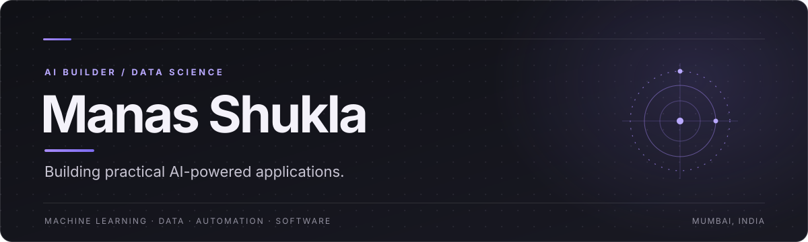

 

<a href="https://manas-shukla-portfolio.framer.website">Portfolio</a>
&nbsp;·&nbsp;
<a href="https://www.linkedin.com/in/manas-shukla-006774370">LinkedIn</a>
&nbsp;·&nbsp;
<a href="mailto:shuklamanas89282@gmail.com">Email</a>
&nbsp;·&nbsp;
<a href="https://github.com/manas-shukla-101?tab=repositories">All repositories</a>

 

## About

I'm **Manas**, a B.Sc. Data Science student interested in building useful products with AI, data and software.

I enjoy taking an idea from a rough concept to a working application — exploring the problem, working with data, connecting APIs and models, and shaping the result into something people can actually use.

**Currently focused on:** applied AI · machine learning · data analytics · intelligent automation

---

## Selected work

A few projects that represent what I like building.

<table>
<tr>
<td width="50%" valign="top">

### [Clarix AI ↗](https://github.com/manas-shukla-101/Clarix-AI)

A browser-based data visualization tool. Upload CSV, JSON or Excel files, explore data and get AI-assisted chart suggestions.

`Data Visualization` `AI` `JavaScript`

</td>
<td width="50%" valign="top">

### [OmniRAG AI ↗](https://github.com/manas-shukla-101/OmniRag-AI)

A retrieval-augmented assistant designed to work across PDFs, CSV files and source code using hybrid search.

`RAG` `Hybrid Search` `Document AI`

</td>
</tr>
<tr>
<td width="50%" valign="top">

### [AI Data Analyst Agent ↗](https://github.com/manas-shukla-101/AI-Data-Analyst-Agent)

An AI-powered data analysis workflow that makes exploratory analysis more interactive, combining dataset analysis, visualizations and automated workflows.

`Python` `Data Analysis` `n8n`

</td>
<td width="50%" valign="top">

### [SmartInbox AI ↗](https://github.com/manas-shukla-101/SmartInbox-AI)

An AI email automation project that classifies and routes Gmail messages, generates smart replies and includes human approval for sensitive actions.

`GPT-4o` `n8n` `Automation`

</td>
</tr>
<tr>
<td width="50%" valign="top">

### [HireSight AI ↗](https://github.com/manas-shukla-101/HireSight-AI)

An AI-assisted resume analyzer that compares resumes with job descriptions, identifies skill gaps and provides recommendations.

`Python` `NLP` `Resume Analysis`

</td>
<td width="50%" valign="top">

### [Customer Churn Prediction ↗](https://github.com/manas-shukla-101/Customer-Churn-Prediction-System)

A machine learning project using XGBoost to predict customer churn, explore churn drivers and segment customers by risk through an interactive dashboard.

`Python` `XGBoost` `Streamlit`

</td>
</tr>
</table>

<a href="https://github.com/manas-shukla-101?tab=repositories">Explore all projects →</a>

---

## Tools & technologies

**Languages & data**

**AI, analytics & automation**

**Application development & tools**

---

## What I'm working towards

- Building stronger foundations in machine learning and data science.
- Creating reliable AI applications that solve clear problems.
- Improving how I design, structure and deploy software.
- Exploring computer vision, retrieval systems and workflow automation.

I'm open to **internships, collaborative projects and opportunities to learn by building**.

---

## GitHub activity

  

**Thanks for stopping by.**

*Always learning. Always building.*

