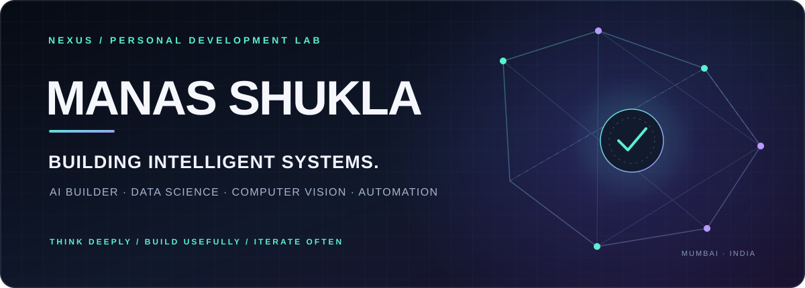
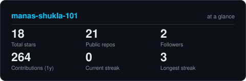

<div align="center">



<br>

<a href="https://manas-shukla-portfolio.framer.website"></a>
<a href="https://linkedin.com/in/manas-shukla-006774370"></a>
<a href="mailto:shuklamanas89282@gmail.com"></a>
<a href="https://github.com/manas-shukla-101?tab=repositories"></a>

</div>

---

<div align="center">

### `NEXUS // PERSONAL DEVELOPMENT LAB`

**I turn ideas into practical AI-powered applications.**

*Data Science · Artificial Intelligence · Computer Vision · Automation*

</div>

```text
┌─ NEXUS / SYSTEM PROFILE ───────────────────────────────────────┐
│                                                                │
│  OPERATOR     Manas Shukla                                     │
│  BASE         Mumbai, India                                    │
│  CURRENT      B.Sc. Data Science student                       │
│  FOCUS        AI/ML • LLM applications • Data • Automation     │
│  APPROACH     Learn → Build → Test → Improve                   │
│                                                                │
│  OBJECTIVE    Build useful software, understand the systems    │
│               behind it, and keep getting better.              │
│                                                                │
└────────────────────────────────────────────────────────────────┘
```

I'm a Data Science student who enjoys building things at the intersection of **AI, software and data**. My projects range from AI-assisted analytics and document intelligence to workflow automation and predictive modelling.

I care about more than getting a demo to work: I like exploring the pipeline behind it, connecting the components, and making the result useful to someone.

---

## `01 / SELECTED BUILDS`

<div align="center">

*Projects that show the kind of problems I like working on.*

</div>

<table>
<tr>
<td width="50%" valign="top">

### [01 · OmniRAG-AI](https://github.com/manas-shukla-101/OmniRag-AI)

**Ask questions across documents and source material.**

A Retrieval-Augmented Generation assistant built around document ingestion, hybrid retrieval and reranking.

`FastAPI` `React` `RAG` `BM25` `Vector Search`

<a href="https://omnirag-ai.onrender.com">LIVE DEMO ↗</a>

</td>
<td width="50%" valign="top">

### [02 · Clarix-AI](https://github.com/manas-shukla-101/Clarix-AI)

**Turn raw data into interactive visual stories.**

A browser-based data visualization tool for CSV, JSON and Excel files, with AI chart suggestions and dashboard building.

`React` `JavaScript` `DuckDB` `ECharts` `Supabase`

<a href="https://clarix-ai-nine.vercel.app">LIVE DEMO ↗</a>

</td>
</tr>
<tr>
<td width="50%" valign="top">

### [03 · AI Data Analyst Agent](https://github.com/manas-shukla-101/AI-Data-Analyst-Agent)

**Make exploratory data analysis more interactive.**

Automates dataset profiling, visualizations, AI-generated insights and report creation, with an n8n workflow.

`Python` `FastAPI` `Pandas` `Gemini` `n8n`

</td>
<td width="50%" valign="top">

### [04 · SmartInbox-AI](https://github.com/manas-shukla-101/SmartInbox-AI)

**An intelligent workflow for managing email.**

Classifies and routes Gmail messages, generates smart replies and uses human approval for sensitive actions.

`OpenAI GPT-4o` `n8n` `LangFlow` `Automation`

</td>
</tr>
<tr>
<td width="50%" valign="top">

### [05 · HireSight-AI](https://github.com/manas-shukla-101/HireSight-AI)

**AI-assisted resume and job-description analysis.**

Matches resumes against job descriptions, identifies skill gaps and produces actionable recommendations.

`Python` `NLP` `AI`

</td>
<td width="50%" valign="top">

### [06 · Customer Churn Prediction](https://github.com/manas-shukla-101/Customer-Churn-Prediction-System)

**Translate customer data into retention signals.**

An end-to-end churn prediction project with risk segmentation, model evaluation and a Streamlit dashboard.

`Python` `XGBoost` `Scikit-learn` `Streamlit`

</td>
</tr>
</table>

<div align="center">

<a href="https://github.com/manas-shukla-101?tab=repositories"><strong>EXPLORE ALL REPOSITORIES →</strong></a>

</div>

---

## `02 / WHAT I WORK WITH`

<table>
<tr>
<td width="33%" valign="top">

**AI & MACHINE LEARNING**

- Python
- Scikit-learn
- TensorFlow / PyTorch
- NLP
- Computer Vision
- LLM applications
- RAG concepts

</td>
<td width="33%" valign="top">

**DATA & ANALYTICS**

- Pandas
- NumPy
- Matplotlib
- Seaborn
- Power BI
- Advanced Excel
- SQL

</td>
<td width="33%" valign="top">

**BUILD & AUTOMATE**

- FastAPI
- Flask
- React
- n8n
- Git & GitHub
- Docker
- PostgreSQL

</td>
</tr>
</table>

<div align="center">


</div>

---

## `03 / CURRENT TRANSMISSION`

```yaml
now:
  learning:
    - strengthening machine learning fundamentals
    - building practical AI and LLM applications
    - improving software architecture and deployment skills
  exploring:
    - computer vision
    - intelligent automation
    - data-driven products
  open_to:
    - internships
    - collaborative projects
    - learning from the developer community
```

---

## `04 / GITHUB TELEMETRY`

<div align="center">




<br>


</div>

---

## `05 / ACTIVITY STREAM`

<div align="center">

<picture>
  <source media="(prefers-color-scheme: dark)" srcset="https://raw.githubusercontent.com/manas-shukla-101/manas-shukla-101/output/snake-dark.svg">
  <source media="(prefers-color-scheme: light)" srcset="https://raw.githubusercontent.com/manas-shukla-101/manas-shukla-101/output/snake.svg">
  
</picture>

<br>


</div>

---

<div align="center">

### `END OF TRANSMISSION`

**Build with curiosity. Ship with purpose. Improve continuously.**

<sub>Thanks for visiting my development lab.</sub>

</div>
